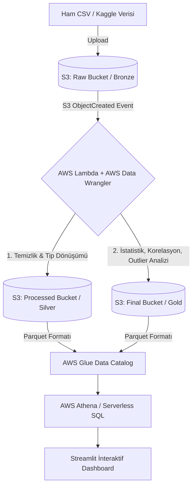

# 🚀 Serverless AWS Medallion Data Pipeline & Auto-EDA Dashboard


Bu proje, herhangi bir ham (raw) veri setini buluta yüklendiği anda otomatik olarak temizleyen, derinlemesine istatistiksel analizlerini (Auto-EDA) çıkaran ve sonuçları interaktif bir web panelinde (Streamlit) görselleştiren **uçtan uca, sunucusuz (serverless) ve olay güdümlü (event-driven) bir veri hattıdır (Data Pipeline).**

Sistem, veri mühendisliğinde endüstri standardı olan **Medallion Mimarisi (Bronze, Silver, Gold)** üzerine inşa edilmiştir.

## 🏗️ Mimari Şema ve Veri Akışı



## ✨ Temel Özellikler

* **Olay Güdümlü Otomasyon:** S3'e (Raw bucket) bir CSV yüklendiği an AWS Lambda otomatik tetiklenir.
* **Akıllı Veri Temizliği (Silver):** Sütun isimleri standartlaştırılır (snake_case, Türkçe karakter temizliği), mükerrer kayıtlar silinir, eksik/Null veriler sayısal değerler için medyan, kategorik değerler için 'Unknown' ile doldurulur.
* **Auto-EDA (Gold):** Temizlenen verinin otomatik olarak;
  * Tanımlayıcı istatistikleri (Ortalama, Min, Max, Çeyreklikler, Basıklık, Çarpıklık)
  * Sütunlar arası Pearson korelasyon matrisi
  * IQR (Interquartile Range) yöntemiyle aykırı değer (Outlier) tespiti ve sayımı
  * Kategorik değişkenlerin frekans ve yüzdelik dağılımları hesaplanır.
* **Performanslı Veri Depolama:** Tüm analiz sonuçları sorgu performansı ve maliyet optimizasyonu için yüksek sıkıştırmalı **Snappy Parquet** formatında kaydedilir.
* **Sunucusuz (Serverless) Sorgulama:** AWS Glue Catalog'a otomatik kaydedilen tablolar AWS Athena ile sıfır altyapı maliyetiyle SQL ile sorgulanır.
* **İnteraktif Dashboard:** Streamlit arayüzü sayesinde tüm bu analizler tek tıkla ısı haritalarına, kutu grafiklerine ve SQL sonuçlarına dönüştürülür. Müşteri/Kullanıcı doğrudan bu panel üzerinden SQL sorguları çalıştırabilir.

## 🛠️ Kullanılan Teknolojiler

* **Bulut Altyapısı:** Amazon Web Services (S3, Lambda, Glue, Athena, IAM)
* **Backend İşleme:** Python 3.12, AWS SDK for Pandas (`awswrangler`), Pandas, NumPy
* **Frontend & Görselleştirme:** Streamlit, Plotly Express
* **IaC / Deployment:** AWS Console (Manuel), AWS CLI

## 🚀 Kurulum ve Çalıştırma Adımları

Bu projeyi kendi bilgisayarınızda çalıştırmak için aşağıdaki adımları izleyin:

### 1. AWS Ön Gereksinimleri
1. Kendi AWS hesabınızda 3 adet S3 kovası oluşturun (`raw`, `processed`, `final`).
2. AWS Glue üzerinde `kaggle_analytics_db` adında boş bir veritabanı oluşturun.
3. Kodu barındıran AWS Lambda fonksiyonunuza (Python 3.12) `AWSSDKPandas` layer'ı ekleyin ve gerekli IAM yetkilerini (S3 Full, Glue Console Full, Athena) tanımlayın.
4. `lambda_func.py` içerisindeki bucket isimlerini kendi oluşturduğunuz isimlerle güncelleyip Lambda'ya deploy edin.

### 2. Bilgisayar (Lokal) Kurulumu
Bilgisayarınızda AWS CLI'ın kurulu olduğundan emin olun ve anahtarlarınızı yapılandırın. Bu adım uygulamanın AWS servislerine güvenli bir şekilde erişebilmesi için zorunludur:

```bash
# AWS kimlik bilgilerinizi güvenli bir şekilde sisteme tanıtın
aws configure

# Sırasıyla şu bilgileri girmeniz beklenecektir:
# AWS Access Key ID [None]: KENDI_ACCESS_KEY_INIZ
# AWS Secret Access Key [None]: KENDI_SECRET_KEY_INIZ
# Default region name [None]: eu-north-1 (veya kovalarınızın bulunduğu bölge)
# Default output format [None]: json
```

### 3. Projeyi İndirme ve Başlatma
Terminale sırasıyla aşağıdaki komutları yazarak projeyi bilgisayarınıza klonlayın ve başlatın:

```bash
# Repoyu klonlayın (Bağlantıyı kendi reponuza göre güncelleyin)
git clone https://github.com/KULLANICI_ADIN/REPO_ADIN.git
cd REPO_ADIN

# Gerekli kütüphaneleri yükleyin
pip install -r requirements.txt

# Streamlit uygulamasını çalıştırın
streamlit run app.py
```

Tarayıcınızda otomatik olarak `http://localhost:8501` açılacaktır.

## 🧪 Kullanım (Nasıl Test Edilir?)
1. Herhangi bir ham veriyi (örneğin Kaggle'dan indirdiğiniz bir `.csv` dosyasını) AWS S3 **Raw** kovanıza yükleyin.
2. Yaklaşık 10-15 saniye bekleyin (Lambda arka planda veriyi işleyip analiz edecektir).
3. Streamlit arayüzüne dönün, sol menüden **"Verileri Yenile"** butonuna tıklayın.
4. Yeni veri setinizi seçip otomatik çıkarılmış korelasyonların, istatistiklerin, kategorik analizlerin ve temiz verinin tadını çıkarın!
5. "💻 Athena SQL Editörü" sekmesine giderek verileriniz üzerinde doğrudan SQL sorguları çalıştırabilirsiniz.

## 📄 Lisans
Bu proje [MIT Lisansı](LICENSE) altında lisanslanmıştır.